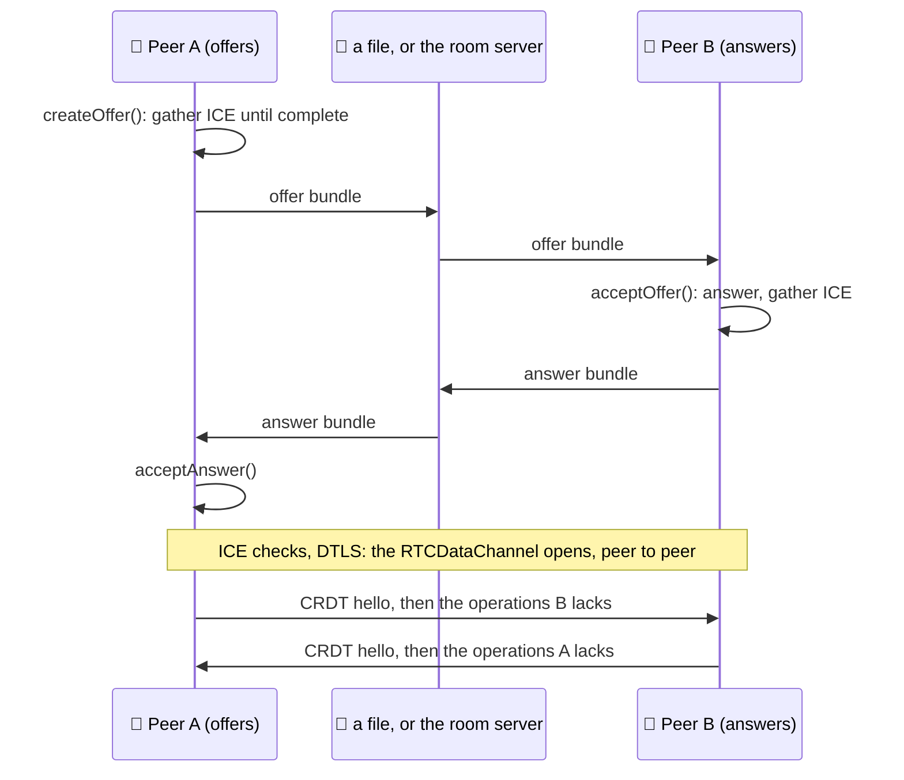

# defuss-webrtc

[](LICENSE)
[](https://www.npmjs.com/package/defuss-webrtc)
[](package.json)
[](tsconfig.json)
[](https://kyr0.github.io/defuss-webrtc/)

**Peer-to-peer** data channels for the browser: one offer and one answer, carried by a file or a tiny room server, and a schema-aware CRDT that keeps a shared JSON document in sync between every peer.

`ManualPeer` wraps `RTCPeerConnection` and hands you signaling as self-contained JSON bundles: complete SDP after ICE gathering, no trickle ICE. The repository ships the room signaling server twice behind one protocol, for Node.js (Express, rooms in memory) and for Vercel (Functions with Upstash Redis). The package has no runtime dependencies.

## TL;DR

Two peers exchange one offer bundle and one answer bundle, by hand or through the room server. Then the `RTCDataChannel` opens, and a CRDT document attached to it syncs state between them. From there, application traffic flows peer to peer; a signaling server never sees it (see [Quick start](#quick-start) and the [live demo](#live-demo)).

- 📨 **Two messages of signaling:** `ManualPeer` waits until ICE gathering is complete (15 s timeout by default), so an offer and an answer are everything two peers exchange
- 📁 **No server needed:** the bundles travel as `PEER.json` files by chat, email, QR code or USB stick; the demo connects two peers this way and chats without any server (browser test)
- 🛰️ **Rooms on a tiny server:** the joiner offers to every member, members answer, and polling every 2 s doubles as the presence heartbeat; one protocol ([`server/PROTOCOL.md`](server/PROTOCOL.md)), two implementations, one conformance suite for both
- 🔀 **Conflict-free by schema:** last-writer-wins registers, counters, add-wins sets, maps and RGA lists; 60 randomized three-replica simulations of 80 mutations each converge
- 🕸️ **Mesh sync:** one document attaches to any number of data channels, forwards new operations to the others and repairs gaps by version vector when a link comes back
- 🔒 **Data stays between peers:** the server holds members, offers and answers, never application data; offers and answers expire after 120 s; server and room passwords are optional and stored as salted HMAC-SHA256
- 🪶 **Zero dependencies:** 11 ES modules, 51.7 kB unminified (10.9 kB gzipped together), with TypeScript declarations
- 🧪 **Tested in real browsers:** 19 Playwright tests drive Chromium peers over genuine WebRTC: full mesh, offline merges, reconnection, rejoin after a server timeout, passwords, file signaling and the website

## How it works



Either way, the flow underneath is the same:

1. Peer A creates an **offer bundle** after ICE gathering is complete.
2. The offer reaches peer B, by hand or through the server.
3. Peer B imports it and creates an **answer bundle**.
4. The answer travels back to A the same way.
5. A imports it; ICE selects a working candidate pair and the `RTCDataChannel` opens.
6. A schema-aware CRDT synchronizes state over that data channel.

| | Out-of-band signaling | Server-based signaling |
| --- | --- | --- |
| Transport | files and messages: WhatsApp, email, QR code, USB stick | HTTP rendezvous server |
| Infrastructure | none | [`server/`](server/README.md) (Express) or [`vercel/`](vercel/README.md) (Vercel Functions + Redis), both in this repo |
| Topology | one peer pair per exchange | rooms; every joiner is meshed with every member automatically |
| Setup time | a human round trip per pair | seconds |
| Access control | whoever receives the file | optional server password and per-room passwords |

| Entry point | When you reach for it | What it does |
|---|---|---|
| **`defuss-webrtc/webrtc`** | connecting two browsers | `ManualPeer`, the bundle helpers `parseSignalBundle`, `serializeSignalBundle`, `signalFileName`, `downloadSignalBundle`, `readSignalFile`, and the ICE candidate parsers |
| **`defuss-webrtc/crdt`** | syncing state | `defineSchema`, `register`, `counter`, `orSet`, `map`, `object`, `list`, `createCrdtDocument`, and the operation, wire and snapshot types |
| **`defuss-webrtc`** | both | Re-exports both entry points, plus the JSON helpers. |
| **`server/`** | a room server on Node.js | Express, rooms in process memory, `PORT` and an optional `SERVER_PASSWORD`. |
| **`vercel/`** | a serverless room server | Vercel Functions with Upstash Redis, one Lua compare-and-swap per room write. |

## Install

```sh
npm install defuss-webrtc   # or: pnpm add defuss-webrtc, bun add defuss-webrtc
```

Without a bundler, the published `dist/` is plain ES modules, so an import map pointing at jsDelivr is enough:

```html
<script type="importmap">
{ "imports": {
  "defuss-webrtc/webrtc": "https://cdn.jsdelivr.net/npm/defuss-webrtc@0.1.0/dist/webrtc/index.js",
  "defuss-webrtc/crdt": "https://cdn.jsdelivr.net/npm/defuss-webrtc@0.1.0/dist/crdt/index.js"
} }
</script>
```

## Quick start

### Out of band: two files, no server

Peer A creates the offer and keeps its tab open until the answer comes back:

```ts
import { ManualPeer, downloadSignalBundle, readSignalFile } from "defuss-webrtc/webrtc";

const peer = new ManualPeer();
const offer = await peer.createOffer();

downloadSignalBundle(offer); // send this JSON file to peer B
console.log(offer.publicEndpoints); // STUN-derived srflx endpoints, if any

// Later, after B returns an answer file:
const answer = await readSignalFile(answerFile);
await peer.acceptAnswer(answer);
const channel = await peer.waitForOpen();

channel.send("hello");
```

Peer B answers it:

```ts
import { ManualPeer, downloadSignalBundle, readSignalFile } from "defuss-webrtc/webrtc";

const offer = await readSignalFile(offerFile);
const peer = new ManualPeer();
const answer = await peer.acceptOffer(offer);

downloadSignalBundle(answer); // return this JSON file to peer A

const channel = await peer.waitForOpen();
channel.addEventListener("message", (event) => {
  console.log(event.data);
});
```

### Through a room server

Rooms follow one rule: **the joiner offers to every existing member**, members answer the offers addressed to them, and a full mesh forms within a few polls. Polling doubles as the presence heartbeat; silent members are dropped after 90 s. The package does not include a room client yet; signaling over the server is plain `fetch` around `ManualPeer`:

```ts
import { ManualPeer } from "defuss-webrtc/webrtc";

const base = "https://signal.example.com/v1/rooms/lobby";
const me = { peerId: crypto.randomUUID(), nickname: "Alice" };
const headers: Record<string, string> = { "Content-Type": "application/json" };
// Only for password-protected servers/rooms (values are percent-encoded):
// headers["X-Server-Password"] = encodeURIComponent(serverPassword);
// headers["X-Room-Password"] = encodeURIComponent(roomPassword);

async function api(method: string, path: string, body?: unknown) {
  const res = await fetch(base + path, { method, headers, body: body === undefined ? undefined : JSON.stringify(body) });
  if (!res.ok) throw new Error((await res.json()).message);
  return res.json();
}

// Join: one fresh offer per existing member.
// (To create the room instead: await api("POST", "", { ...me, password: "optional" }).)
const { members } = await api("GET", "/members");
const pending = new Map<string, ManualPeer>(); // sessionId -> peer awaiting an answer
const offers = [];
for (const member of members) {
  const peer = new ManualPeer({ peerId: me.peerId });
  const bundle = await peer.createOffer({ metadata: { nickname: me.nickname } });
  pending.set(bundle.sessionId, peer);
  offers.push({ to: member.peerId, bundle });
}
await api("POST", "/join", { ...me, offers });

// Poll: complete my offers, answer offers addressed to me.
const answered = new Set<string>();
setInterval(async () => {
  const state = await api("GET", `/members?peerId=${encodeURIComponent(me.peerId)}`);
  for (const answer of state.answers) {
    const peer = answer.to === me.peerId ? pending.get(answer.sessionId) : undefined;
    if (!peer) continue;
    pending.delete(answer.sessionId);
    await peer.acceptAnswer(answer.bundle);
    peer.waitForOpen().then((channel) => doc.attach(channel)); // doc: a CrdtDocument, see below
  }
  for (const offer of state.offers) {
    if (offer.to !== me.peerId || answered.has(offer.sessionId)) continue;
    answered.add(offer.sessionId);
    const peer = new ManualPeer({ peerId: me.peerId });
    const bundle = await peer.acceptOffer(offer.bundle, { metadata: { nickname: me.nickname } });
    await api("POST", "/answers", { from: me.peerId, to: offer.from, sessionId: offer.sessionId, bundle });
    peer.waitForOpen().then((channel) => doc.attach(channel));
  }
}, 2000);
```

This sketch leaves out leaving (`POST /leave`), error handling and *mesh repair* for peers that joined at the same moment (PROTOCOL.md §6.4). [`docs/demo/app.js`](docs/demo/app.js) is the complete reference client, which the browser suite drives.

### Sync state with a CRDT

The schema is executable metadata for the merge layer: each path has explicit conflict semantics.

```ts
import { createCrdtDocument, defineSchema, register, counter, orSet, map, object, list } from "defuss-webrtc/crdt";

const schema = defineSchema({
  title: register("Untitled"),      // Lamport-LWW register
  votes: counter(0),                // commutative delta counter
  tags: orSet<string>([]),          // observed-remove, add-wins set
  users: map(object({               // LWW key lifecycle + nested CRDTs
    name: register(""),
    score: counter(0),
  })),
  messages: list<{ text: string }>([]), // RGA-style sequence + tombstones
});

const doc = createCrdtDocument({ id: "room-42", actorId: peer.peerId, schema });
doc.attach(await peer.waitForOpen());

doc.set(["title"], "Shared notes");
doc.increment(["votes"], 1);
doc.setAdd(["tags"], "p2p");
doc.set(["users", "alice", "name"], "Alice"); // map key auto-created
doc.listInsert(["messages"], 0, { text: "hello" });

console.log(doc.state);
```

### TURN fallback

The default STUN server is Cloudflare's public `stun:stun.cloudflare.com:3478`. Pass `iceServers` to override it or add TURN; it works the same for both signaling modes. No TURN credentials are bundled.

```ts
const peer = new ManualPeer({
  iceServers: [
    { urls: "stun:stun.cloudflare.com:3478" },
    {
      urls: ["turn:turn.example.com:3478?transport=udp"],
      username: "ephemeral-user",
      credential: "ephemeral-password",
    },
  ],
});
```

## Live demo

[kyr0.github.io/defuss-webrtc](https://kyr0.github.io/defuss-webrtc/) serves `docs/`, built with defuss-shadcn from its CDN. The landing page explains both signaling paths and the CRDT sync in animated sequence diagrams, compares the two servers and their room data model, runs a CRDT merge explorer on the library build it ships, and starts two chat peers side by side on a click. The demo itself (`docs/demo/`) connects step by step (mode, signaling server, this peer, room or files), then switches to the chat; a *Peer devtools* tab shows the connections, the live CRDT document and the log.

```sh
bun run dev   # bunx serve of docs/ on http://localhost:3000, or the free port it prints
make site     # copies a fresh library build to docs/dist after changing src/
```

VERIFIED by `e2e/browser/site.spec.mjs` and `e2e/browser/chat.spec.mjs` (part of `make e2e`):

- **Nothing loads before a click.** The landing page has no demo frame until the visitor starts it, so reading sends no request to the signaling server.
- **Two peers in one tab.** Same-origin frames share `sessionStorage`, so each frame keeps its identity under its own key (`?peer=a`, `?peer=b`); the test sees two peer ids, joins both to one room through the local server and chats.
- **The explorer is the library.** Its presets run the shipped `docs/dist/` build, and the test checks every stated outcome: last writer wins, counters add up, add wins over a concurrent delete, both list inserts survive, a deleted map entry stays deleted.
- **Clean pages.** Every landing-page test fails on a console error, a failed request or an HTTP error response, also at phone width.

[`docs/README.md`](docs/README.md) covers hosting on GitHub Pages and the demo's reconnection behavior.

## API

### `ManualPeer`

One `ManualPeer` is one `RTCPeerConnection` with one ordered data channel, for one pairing.

| Member | Returns | Semantics |
|---|---|---|
| `new ManualPeer(options?)` | `ManualPeer` | Requires a WebRTC-capable browser or runtime. |
| `createOffer({ metadata? })` | `Promise<OfferSignalBundle>` | Creates the data channel and the offer; resolves after ICE gathering. `metadata` is a string record, for example a nickname. |
| `acceptOffer(offer, { metadata? })` | `Promise<AnswerSignalBundle>` | Takes a bundle or its JSON text and answers it. |
| `acceptAnswer(answer)` | `Promise<void>` | Completes the offerer's side. |
| `waitForOpen(timeoutMs = 20000)` | `Promise<RTCDataChannel>` | The data channel once it is open. |
| `waitForDataChannel(timeoutMs = 20000)` | `Promise<RTCDataChannel>` | The data channel as soon as it exists, open or not. |
| `peerId`, `connection`, `dataChannel` | properties | The logical peer identity, the `RTCPeerConnection`, the channel or `null`. |
| `close()` | `void` | Closes the channel and the connection. |

| Option | Default |
|---|---|
| `peerId` | a random id |
| `iceServers` | `[{ urls: "stun:stun.cloudflare.com:3478" }]` |
| `rtcConfiguration` | everything else of `RTCConfiguration` |
| `iceGatheringTimeoutMs` | 15000; past it, `createOffer()` / `acceptOffer()` reject |
| `channelLabel` | `"defuss"` |
| `channelOptions` | `{ ordered: true }` |

### Signal bundles

Both signaling modes carry the same JSON: `protocol` (`"defuss-webrtc/manual-signal/1"`), `version`, `kind` (`"offer"` or `"answer"`), `sessionId`, `peerId`, `createdAt`, `description` (complete SDP), `candidates`, `publicEndpoints` (STUN-derived addresses), optional `metadata`, and for answers `replyTo`. `parseSignalBundle()` rejects anything else.

### CRDT

`createCrdtDocument({ id, schema, actorId?, maxMessageBytes = 65536, maxBufferedAmount = 524288 })`:

| Schema node | Mutation API | Merge semantics |
| --- | --- | --- |
| `register(initial)` | `doc.set(path, value)` | Lamport-LWW; `(clock, actor, seq)` total-order tie break |
| `counter(initial)` | `doc.increment(path, delta)` | unique immutable deltas summed once |
| `orSet(initial)` | `doc.setAdd`, `doc.setDelete` | observed-remove/add-wins OR-set |
| `map(valueSchema)` | nested mutations, `mapEnsure`, `mapDelete` | LWW key lifecycle; re-put starts a fresh nested generation |
| `object(fields)` | child mutation | static field container |
| `list(initial)` | `listInsert`, `listSet`, `listDelete` | RGA-style immutable element IDs + tombstones |

| Document member | Semantics |
|---|---|
| `state`, `get(path)` | The materialized JSON as a fresh copy; one path of it. |
| `subscribe(listener)` | Called with `{ origin: "local" \| "remote" \| "import", ops, state }`; returns an unsubscribe function. `onError(listener)` reports wire and schema errors. |
| `batch(fn)` | Several writes, one broadcast and one notification. |
| `attach(channel)` | Syncs over a reliable, ordered `RTCDataChannel`, any number of them; returns `detach`. `close()` detaches all. |
| `export()`, `merge(snapshot)` | The operation set as a JSON snapshot; merging returns how many operations were new. |
| `versionVector`, `operationCount` | The highest contiguous `seq` per actor; the number of operations held. |

On a channel, both sides send `hello` (canonical schema, its fingerprint, version vector) when it opens, then the `ops` the other side lacks, then every new operation. Schema equality is checked on the exact canonical schema descriptor; `schemaFingerprint` is only a compact diagnostic. A different schema, document or protocol rejects the channel with an `error` message.

### Room server HTTP

Base path `/v1`, JSON in and out, CORS open. [`server/PROTOCOL.md`](server/PROTOCOL.md) is normative.

| Endpoint | Body | Success |
|---|---|---|
| `GET /v1/rooms` | | room summaries by `createdAt` |
| `POST /v1/rooms/{name}` | `{ peerId, nickname, password? }` | `201` room state; the caller is moderator |
| `POST …/{name}/join` | `{ peerId, nickname, offers: [{ to, bundle }] }` | room state |
| `GET …/{name}/members?peerId=` | | room state; renews the caller's `lastSeen` |
| `POST …/{name}/offers` | `{ from, to, bundle }` | `201`, a late offer for mesh repair |
| `POST …/{name}/answers` | `{ from, to, sessionId, bundle }` | `201`; consumes the offer, idempotent |
| `POST …/{name}/leave` | `{ peerId }` | removes the member, its offers and answers |

- **Server password:** start the server with `SERVER_PASSWORD=…`; every request must then send `X-Server-Password`.
- **Room password:** pass `password` when creating a room; every later request for that room must send `X-Room-Password`. `GET /v1/rooms` marks such rooms `protected: true`.

Passwords are shared secrets, not per-member accounts (see PROTOCOL.md §2.1 and §8).

## Signaling servers

Both implementations return identical responses; they differ in where a room lives and how it expires.

| | [`server/`](server/README.md), Node.js | [`vercel/`](vercel/README.md), Vercel Functions |
|---|---|---|
| Rooms live in | the memory of one process; a restart empties it | Upstash Redis: one JSON document `{ revision, room }` per room, plus a sorted index of room names |
| Atomic writes | each request runs synchronously on one event loop | a Lua compare-and-swap on the revision, retried up to 24 times |
| Expiry | a sweep every 30 s: members after 90 s without a poll, offers and answers after 120 s | lazily on every room access and listing, plus a 180 s key TTL as a safety net |
| Run | `cd server && npm install && npm run dev` | Vercel project with Root Directory `vercel`, `npx vercel` |

A room holds its members (`peerId`, nickname, role, `joinedAt`, `lastSeen`) and the offers and answers in flight between them, keyed by `sessionId`. The creator is the moderator; when the moderator leaves or times out, the member with the smallest `joinedAt` takes over. The room is deleted with its last member. The [live demo](#live-demo) shows this model as an ER diagram.

## When to use it

`defuss-webrtc` trades a backend for your data against a signaling step and a full mesh: the server only introduces peers, and every peer holds the whole document.

### Use it for

- **Small rooms that share state:** chat, notes, boards, a game's durable state, synced peer to peer with no data backend
- **Offline-first apps:** replicas write while apart and merge later, over a channel or from an exported snapshot
- **Two devices with no server at all:** two `PEER.json` files connect them

### Use something else for

- **Large rooms:** a full mesh needs N·(N−1)/2 connections, and every peer polls the server every 2 s
- **Audio, video or screen sharing:** not supported yet; see [ROADMAP.md](ROADMAP.md)
- **Guaranteed connectivity without TURN:** STUN-only is best effort
- **Long write-heavy histories:** the operation log only grows; [ROADMAP.md](ROADMAP.md) measures an 11.5 MiB snapshot at 60,000 operations
- **Members you do not trust:** there is no per-member authentication, and `peerId` is self-asserted

### Key principles

1. **An IP address is not a peer identity.** `peerId` is the logical replica and peer identity; STUN-derived `srflx` addresses are transient network locators.
2. **A bundle is signaling state, not a durable contact card.** The originating `RTCPeerConnection` must stay alive while its offer waits for an answer. ICE credentials, NAT bindings and candidates belong to one session.
3. **STUN-only is best effort.** Some NAT and firewall combinations cannot establish a direct path; add TURN through `iceServers` when connectivity must be reliable.
4. **Treat bundles as sensitive.** Offer and answer JSON contains SDP, ICE credentials, candidate addresses and DTLS fingerprints, also when it passes through a signaling server, which should therefore sit behind TLS.

## Patterns

### Offline or import merge

```ts
const snapshot = doc.export();
localStorage.setItem("room-42", JSON.stringify(snapshot));

const other = createCrdtDocument({ id: "room-42", actorId: "new-peer", schema });
other.merge(localStorage.getItem("room-42")!);
```

Snapshots contain the immutable operation set. That keeps merging simple, correct and idempotent, but the log grows with every mutation. Compaction is deliberately not implemented in 0.1, because safe compaction needs causal stability and peer-retirement semantics.

### Multi-peer

A document may attach to several reliable ordered data channels. Newly learned operations are deduplicated by `(actor, seq)` and forwarded to the other attached channels. Version-vector frontiers repair missing prefixes on attach and reconnect.

```ts
doc.attach(channelToB);
doc.attach(channelToC);
```

### Reliability and backpressure

`CrdtDocument.attach()` requires a **reliable ordered** `RTCDataChannel` and rejects channels configured with `maxRetransmits` or `maxPacketLifeTime`. Messages are capped at 64 KiB by default and queued while `bufferedAmount` is high; both limits are configurable.

## What "verified" means

```sh
make verify   # lint → test → coverage → e2e; CI runs the same after `make setup`
```

- `make lint`: oxlint with `--deny-warnings`, and a type check of the Vercel package
- `make test`: 40 unit tests (13 library, 13 Express server, 14 Vercel functions), and a check that `docs/dist` equals a fresh build
- `make coverage`: line coverage over all three packages, 82.34% on 2026-10-10
- `make e2e`: the packed tarball in a clean consumer, the HTTP conformance suite against the built server (29 tests together), and 19 Playwright tests in Chromium

The library tests cover a strict TypeScript build, deterministic convergence, OR-set observed-remove and add-wins, map generation, delete and recreate, RGA lists, anti-entropy over a test data channel, version-vector gap repair, 60 randomized three-replica simulations of 80 mutations each, and the ICE candidate and bundle parsers. `tests/browser-smoke.html` is a separate same-browser two-peer WebRTC check.

### Signaling server end-to-end tests

`e2e/signaling.test.mjs` is one protocol conformance suite (dependency-free, `node:test` + `fetch`) that runs against **any** signaling server over real HTTP. It asserts exact statuses, error codes and messages, so passing on two targets means they behave identically:

```sh
npm run test:e2e                          # builds and spawns the local Express server (with a server password)
E2E_SERVER_PASSWORD= npm run test:e2e     # ... as an open server

E2E_BASE_URL=https://defuss-webrtc.vercel.app npm run test:e2e:remote   # any deployment
```

| Variable | Meaning |
| --- | --- |
| `E2E_BASE_URL` | Target origin. Unset: spawn the local Express server from `server/dist`. |
| `E2E_SERVER_PASSWORD` | The target's server password, if it has one (enables the server-password tests). Locally: the password the spawned server gets; `""` spawns an open server. |
| `E2E_VERCEL_BYPASS` | "Protection Bypass for Automation" secret, for Vercel deployments behind Deployment Protection. |

Runs use unique room names and leave their rooms afterwards, so they are safe against a shared deployment. Member and signal expiry (90 s / 120 s) is covered by the unit tests, not here. One known platform difference: Vercel's edge rejects malformed percent-encoding in the URL path itself (plain-text `400`) before the function runs; the suite accepts that and reports it as a diagnostic.

### Browser tests (Playwright)

`e2e/browser/chat.spec.mjs` drives the chat app (`docs/demo/index.html`) in several isolated Chromium contexts, one per peer, each with its own identity. It connects them through a signaling server and chats over genuine WebRTC data channels: a three-peer full mesh with message fan-out, concurrent sends converging to one order, history sync for late joiners, leaving, password-protected rooms and wrong server passwords. It also covers reconnection (a dropped link healing after divergent offline writes, a reloaded tab rejoining with the same identity, a peer the server timed out rejoining automatically, hidden tabs polling slowly) and two peers that connect by swapping PEER.json files, with no server, and chat. `e2e/browser/site.spec.mjs` covers the landing page (`docs/index.html`): every section, the diagrams, the CRDT explorer, the two-peer demo chatting through the local server, the theme switch and the phone layout.

```sh
npx playwright install chromium        # once, if the browser is not installed yet
npm run test:browser                   # local Express server (with a server password) + docs site
E2E_BASE_URL=https://defuss-webrtc.vercel.app npm run test:browser   # a deployed server
```

The site is served from `docs/` with `/dist/` mapped to a fresh library build, so the tests always run the current source. `E2E_SERVER_PASSWORD` works as for the HTTP suite; `E2E_DOCS_PORT` / `E2E_SIGNAL_PORT` override the local ports (47173 / 47787). Chromium runs with mDNS host-candidate obfuscation disabled: `.local` candidates do not resolve on many CI and sandboxed hosts, so peers would never connect. The pages load defuss-shadcn from jsDelivr, so the tests need internet access. On failure, each peer's in-app log is attached to the report.

**Against a deployment, requests cost money.** Every open peer tab polls the signaling server about once per second, so with `E2E_BASE_URL` only the two `@remote` smoke tests run (mesh chat and protected room, roughly 50–60 requests), on one worker, stopping at the first failure; waits abort as soon as a peer logs a signaling failure instead of polling until the timeout. `E2E_REMOTE_ALL=1` runs the whole suite remotely. Each run prints the number of signaling requests it sent. Hunt flakes against the local server, never with `--repeat-each` against a deployment.

### Deliberate limits

No room client in the package yet (the [sketch](#through-a-room-server) and the demo show the protocol), no compaction of the operation log, no media tracks. Peers must share the exact canonical schema; values are JSON, at most 64 KiB per wire message by default. Browser tests run in Chromium only. Open work, including audio, video and screen sharing, CRDT compaction, schema evolution, a realtime side channel and server hardening, is tracked in [ROADMAP.md](ROADMAP.md).

## Repository layout

- `src/`: the `defuss-webrtc` package: `ManualPeer` and signal bundles (`defuss-webrtc/webrtc`), and the CRDT layer (`defuss-webrtc/crdt`).
- `docs/`: the GitHub Pages site (`bun run dev` serves it locally): a landing page that explains signaling, the room server and the CRDT, with a merge explorer, plus the P2P chat demo in `docs/demo/`. The demo supports **both** signaling modes, rooms via a signaling server or the manual PEER.json file exchange, and syncs CRDT chat state over data channels in a full peer mesh. See [`docs/README.md`](docs/README.md).
- `server/`: Express room signaling server (rooms, offer/answer brokering, presence, optional passwords). `server/PROTOCOL.md` is the protocol spec.
- `vercel/`: the same protocol as Vercel Functions with Upstash Redis, for serverless deployments.

## Requirements

- **Browser** with WebRTC for `ManualPeer`; the CRDT layer also runs in Node.js, where its tests run
- **Node.js** 20 or later (`engines`); development is pinned to Node 24.14.0 in `mise.toml`
- **npm** 11.9.0 (`packageManager`) installs and runs the packages; **Bun** 1.4.2 runs `bun run dev`
- **Browser tests:** Chromium through Playwright, with internet access for the CDN

## Citation

If you use defuss-webrtc in research or want to reference it, cite it as:

```bibtex
@misc{homberg2026defusswebrtc,
  author       = {Homberg, Aron},
  affiliation  = {Independent Researcher},
  title        = {defuss-webrtc: WebRTC Data Channels with File or Room Signaling and Schema-Aware CRDT Sync},
  year         = {2026},
  version      = {0.1.0},
  howpublished = {\url{https://github.com/kyr0/defuss-webrtc}},
  note         = {MIT License}
}
```

## License

MIT, see [LICENSE](LICENSE).
